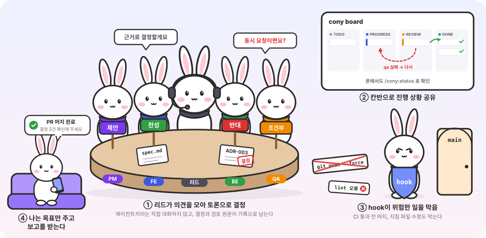

# cony

<p align="center">
  
</p>

Claude Code용 개인 플러그인 마켓플레이스. `pm`(기획) · `fe`(클라이언트) · `be`(백엔드) · `qa`(테스트) 4인 에이전트 팀이 스스로 토론해 결정하고, 기능을 머지까지 만든 뒤 보고하는 하네스 `cony`가 들어 있다.

## 어떻게 동작하나

1. **토론으로 결정**: 리드(메인 세션)가 pm의 제안을 fe·be·qa에게 검토시키고, 근거로 결정해 ADR과 검토 원문을 남긴다. 에이전트끼리는 직접 대화하지 않는다.
2. **칸반으로 진행**: 태스크는 PROGRESS → REVIEW → DONE으로 움직이고, qa 검증에서 실패하면 다시 PROGRESS로 돌아간다.
3. **hook이 지킴**: force push, CI 통과 전 머지, 지침 파일 수정, lint 오류를 막는다.
4. **사용자는 보고만**: 목표를 주고, 보드나 폰으로 지켜보다가 머지 완료와 확인할 결정을 보고받는다.

## 설치

```bash
claude plugin marketplace add hwanyoungChoi/cony
claude plugin install cony@conychoi-plugins
claude plugin install development@conychoi-plugins   # 개인 컴퓨터에서만
```

| 플러그인 | 내용 | 원본 |
|---|---|---|
| `cony` | 하네스: 에이전트 4명, hook, 팀·보드·상태·세팅 스킬 | 이 저장소 |
| `development` | `commit-message`, `code-review-fe`, `spec-review` 스킬 | [my-plugins](https://github.com/hwanyoungChoi/my-plugins)를 가리키기만 한다 |

- 스킬은 my-plugins에서 고치고 push하면 된다. 여기서는 `claude plugin marketplace update conychoi-plugins`로 최신을 받는다.
- 회사 컴퓨터에는 사내 `development` 플러그인이 같은 스킬을 같은 이름으로 제공하므로 `development@conychoi-plugins`는 설치하지 않는다. 둘을 같이 설치하면 스킬 이름이 겹친다.
- 팀 흐름에서 기획서가 있으면 `spec-review`, REVIEW 단계에서 `code-review-fe`, 커밋할 때 `commit-message`를 쓴다.

### 업데이트

```bash
claude plugin marketplace update conychoi-plugins
claude plugin update cony@conychoi-plugins
```

업데이트는 **실행 중인 세션에도 바로 반영된다.** 에이전트·스킬 이름처럼 호환이 깨지는 변경은 팀이 작업 중인 세션을 끊을 수 있으니, 그 세션이 쉬는 틈에 올리고 바뀐 점을 알려준다.

## 사용

```
/cony:setup                       # 새 프로젝트에 하네스 깔기 (한 번)
/cony:team 프로필 사진 업로드 기능   # 목표만 주면 팀이 알아서 끝까지
/cony:status                      # 언제든 중간보고 (다른 세션에서도 됨)
/cony:board                       # 진행 상황을 브라우저 대시보드로 (실시간 갱신)
```

`/cony:board`는 `.cony/`를 감시하는 로컬 서버(`localhost:4747`)를 띄운다. **보드** 탭과 **지표** 탭이 있다. 태스크는 **BACKLOG · TODO · PROGRESS · REVIEW · DONE** 칸반으로 보이고, 리드가 보드를 갱신하는 즉시 카드가 옮겨간다. 확인 필요·막힌 것 배너, 결정 기록, 검토 기록(최신 라운드부터 `PM` `FE` `BE` `QA` 배지와 판정)도 함께 보인다. 이 컴퓨터에서만 열리므로 폰에서는 아래 Remote Control을 쓴다.

**지표** 탭은 cony가 값어치를 하는지 숫자로 보여준다. 역할별 토큰(Claude Code 대화 기록에서 자동 집계), 완료 태스크와 소요 시간, qa 되돌림, 흐름 규칙 건너뜀, 반대·조건부 의견이 있었던 결정 비율, 사용자가 뒤집은 결정, 사람 개입 횟수, hook이 막은 횟수. 비슷한 크기의 기능을 cony 팀과 일반 세션으로 각각 만들어 이 숫자를 비교하면 팀 구조의 효과를 판단할 수 있다.

## 하네스 구성

| 요소 | 질문 | cony가 갖춘 것 |
|---|---|---|
| 컨텍스트 | 무엇을 알고 시작하는가 | `CLAUDE.md` 작업 원칙, `CONVENTIONS.md`, 스펙, 결정 기록, 세션 시작 시 보드 자동 주입 |
| 도구 | 무엇을 할 수 있는가 | 역할별 에이전트 4명, 브라우저·시뮬레이터 화면 확인, 검증 명령 권한 허용 목록 |
| 제약 | 무엇을 못 하게 막는가 | hook: 지침 파일 수정 차단(사람만 수정), 비밀 파일(`.env`·`.dev.vars` 등) 읽기 차단, `--no-verify`·`--amend`·force push 차단, CI 미통과 PR 머지 차단, `main` 직접 push·`reset --hard`·DB 리셋은 승인 필요 |
| 피드백 루프 | 틀렸다는 걸 어떻게 아는가 | hook: 파일 수정 즉시 ESLint, 종료 전 lint + typecheck(실패하면 못 끝냄), 보드가 "진행 중"인 채로 리드가 턴을 끝내면 갱신 요구, 리드 세션 종료 시 보드를 "중단됨"으로 표시(상태만 보는 세션은 해당 없음), 커밋 전 husky, qa의 독립 검증 |
| 흐름 | 어떤 순서로 일하는가 | `board.mjs`가 단계 건너뛰기를 막는다(qa 기록·커밋 없이 DONE 불가, `--skip-reason`은 기록으로 남음). `/cony:team`: 작업 브랜치 → 기획 → 스펙 토론 → 태스크마다 PROGRESS(구현) → REVIEW(화면 확인·qa·`code-review-fe`) → DONE(커밋) → PR → CI 통과 시 머지 → 보고 |
| 개선 | 실수가 어떻게 규칙이 되는가 | `log.md`의 `되돌림`·`놓침` → 보고서의 "규칙 제안" → 사람이 `CLAUDE.md`나 hook으로 승격. 지표 탭으로 효과를 측정 |

hook은 `.cony/` 디렉토리가 있는 프로젝트에서만 동작한다. 세션을 연 폴더가 아니어도, 수정한 파일 경로나 `cd`·`git -C`로 들어간 위치가 cony 프로젝트면 동작한다. 다른 프로젝트에는 영향이 없다.

## 팀

| 에이전트 | 역할 | 만들 때 | 검토할 때 보는 것 |
|---|---|---|---|
| `pm` | 기획 | 스펙, 태스크, 선택지 | 요구사항, 범위 |
| `fe` | 클라이언트 | 화면, API 연동 | 화면 흐름, 사용성 |
| `be` | 백엔드 | DB, 마이그레이션, API | 데이터 무결성, 보안, API 계약 |
| `qa` | 테스트 | 테스트 작성·실행 | 테스트 가능성 |

### 실제 실패에서 나온 팀 규칙

| 규칙 | 담당 | 계기 |
|---|---|---|
| 쓰는 경험을 좌우하는 제품 기본값은 제안값으로 진행하고 사용자에게 확인 | 리드, pm | 모기지핏에서 사용자가 뒤집은 결정 5개가 전부 이 종류 |
| 외부 입력(공유 텍스트, 파일, 외부 API 응답)에 기대는 기능은 실제 샘플 확보가 먼저 | pm | 가정으로 만든 붙여넣기 기능이 통째로 삭제됨 |
| 스펙 검토 때 수용 기준의 예시 값을 직접 계산 | qa | 내림·반올림을 구분 못 하는 예시, 틀린 경계 예시 |
| 비밀 파일을 읽지 않고, 스크립트가 몰래 읽는 경우도 확인. 실제 키로 외부 API 호출은 사용자 확인 후 | be (+ hook) | 테스트 중 `.dev.vars`의 실제 키로 외부 API를 부름 |
| 범위는 한 번에 태스크 3개, 수용 기준 8개 이하 | pm | "계산기 만들어줘" 한 줄에 수용 기준 20개 |

### 팀 구성 바꾸기

프로젝트마다 `.cony/team.json`으로 역할을 고른다. 파일이 없으면 전원 `build`다. `/cony:setup`이 처음에 묻는다.

```json
{ "pm": "build", "fe": "build", "be": "review", "qa": "build", "decisions": "team" }
```

| 값 | 뜻 | 예 |
|---|---|---|
| `build` | 에이전트가 직접 만든다 | 혼자 하는 개인 프로젝트 |
| `review` | 사람 담당자가 만들고, 에이전트는 토론·검토와 **넘길 문서**만 | 백엔드는 사내 팀이 맡을 때 `be: review` → 백엔드 요청서를 써서 전달 |
| `off` | 이 프로젝트에 없다 | 서버 없는 정적 사이트면 `be: off` |

`review` 역할이 쓰는 문서는 `.cony/handoffs/`에 남고 보드의 "사람에게 넘길 문서"에 보인다: pm은 기획 질의서, fe는 구현 요청서, be는 백엔드 요청서(엔드포인트·요청·응답 예시·에러), qa는 테스트 시나리오. be가 `review`면 fe는 API 계약대로 목 데이터로 화면을 먼저 만든다.

**큰 결정을 누가 확정할지**도 고른다(`decisions`). `team`(기본)은 팀이 토론으로 확정하고 제품 기본값만 묻는다. `user`는 팀이 선택지·검토 의견·추천까지만 내고 사용자가 고른다. 채용 과제처럼 사람의 판단이 기록에 드러나야 하거나, 회사 프로젝트처럼 결정 권한이 사람에게 있을 때 쓴다. 되돌리기 쉬운 구현 세부는 어느 쪽이든 담당 에이전트가 정한다. 지표 탭에 "사용자가 확정한 결정"과 "사용자 결정 대기" 수가 나온다.

**중간에 바꿔도 된다.** "be 투입", "qa는 빼"라고 말하거나 파일을 고치면 다음 태스크부터 적용되고, 새로 들어온 역할은 지금까지의 스펙·결정·변경을 먼저 검토하며 따라잡는다.

에이전트끼리는 직접 대화하지 못한다. 메인 세션이 리드가 되어 의견을 전달하며 토론을 진행한다. 검토는 읽고 판정만 하므로 `sonnet`으로, 첫 스펙과 구현은 에이전트 기본 모델로 부른다.

1. **제안**: 담당자가 선택지 2~3개와 추천
2. **검토**: 다른 역할들이 병렬로 찬성/반대와 근거
3. **반론**: 이견이 있으면 제안자가 1회 응답
4. **결정**: 리드가 근거로 판정 (CLAUDE.md 제약 → 작업 원칙 → 테스트 가능성 → 되돌리기 쉬운 쪽)
5. **기록**: `.cony/decisions/NNN-*.md`에 결정을, `.cony/reviews/`에 검토자가 직접 쓴 원문을 남긴다

사용자에게는 되돌릴 수 없는 일(배포, 데이터 삭제, 유료 서비스, `main` 직접 push), 지침 파일 변경, 제품 목표가 갈리는 해석, **쓰는 경험을 좌우하는 제품 기본값**(기본값, 포함·제외 항목, 저장 후 동작, 화면 취향)일 때만 묻는다. 마지막 항목은 모기지핏에서 사용자가 뒤집은 결정 5개가 전부 이 종류였던 데서 나온 규칙이다. 제안 기본값으로 진행하되 확인을 요청한다.

## 머지까지 자동으로

1. `cony/{feature}` 브랜치에서 태스크마다 커밋하고 push
2. 끝나면 PR 생성. 본문은 최종 보고서
3. CI 실패는 담당 에이전트가 최대 2회 수정
4. CI가 모두 통과하면 squash 머지. **hook이 `gh pr merge` 직전에 CI 결과를 다시 확인하고, 통과하지 않았으면 막는다**
5. 머지 후에도 PR과 `.cony/decisions/`가 남아서, 나중에 팀의 결정을 검토하고 뒤집을 수 있다

개인 계정 private 저장소는 무료 플랜에서 브랜치 보호를 못 쓰기 때문에, GitHub 설정 대신 hook으로 "CI 통과 후 머지"를 강제한다. CI 워크플로는 `/cony:setup`이 만든다.

## 폰에서 지켜보기

1. Claude 데스크톱 앱에서 `/cony:team`을 시킨 세션의 **Remote Control**을 켠다
2. Claude 모바일 앱이나 claude.ai/code에서 그 세션을 열면 실시간으로 보이고, 메시지도 보낼 수 있다
3. 팀은 사용자 확인이 필요할 때, 전부 막혔을 때, CI 실패로 머지를 보류할 때, 머지했을 때만 푸시 알림을 보낸다
4. 중간보고는 폰에서 `/cony:status`. 리드 세션이 멈춰 있으면 알려주고, 원하면 그 세션에 재개 메시지를 보낸다(리드는 보드에 자기 세션 ID를 남겨 둔다. 데스크톱 앱에서만)

Remote Control은 세션을 돌리는 컴퓨터가 켜져 있어야 한다. 잠자기에 들어가면 끊긴다.

## 작업 공간 `.cony/`

| 경로 | 내용 |
|---|---|
| `board.md` | 현황판. 리드가 단계마다 `board.mjs`로 갱신 |
| `specs/` | 스펙과 태스크 |
| `decisions/` | 토론 기록 (ADR). 결정과 의견 요약 |
| `team.json` | 역할별 build·review·off |
| `handoffs/` | `review` 역할이 사람 담당자에게 넘길 문서 |
| `reviews/` | 검토 원문과 qa 검증 기록(`…-qa-task-{N}.md`, 이게 있어야 DONE). 검토자가 직접 쓴다. `20261022-1430-fe-adr-003.md`처럼 시각-역할-대상 순이라 이름순이 곧 시간순 |
| `log.md` | 작업 기록 (`요청` / `토론` / `AI` / `되돌림` / `놓침`) |
| `reports/` | 최종 보고서 |
| `metrics/events.jsonl` | 태스크 상태 변화, 규칙 건너뜀, hook 차단 기록 (지표의 원천) |
| `.cache/` | hook 상태 (gitignore) |

## 개발

hook이나 보드 스크립트를 고친 뒤에는 테스트를 돌린다. 실제 ESLint·tsc·gh 대신 가짜 실행 파일을 써서 의존성 없이 몇 초 만에 끝난다. push하면 GitHub Actions에서도 돈다.

```bash
node --test tests/hooks.test.mjs tests/board.test.mjs tests/stats.test.mjs
```
