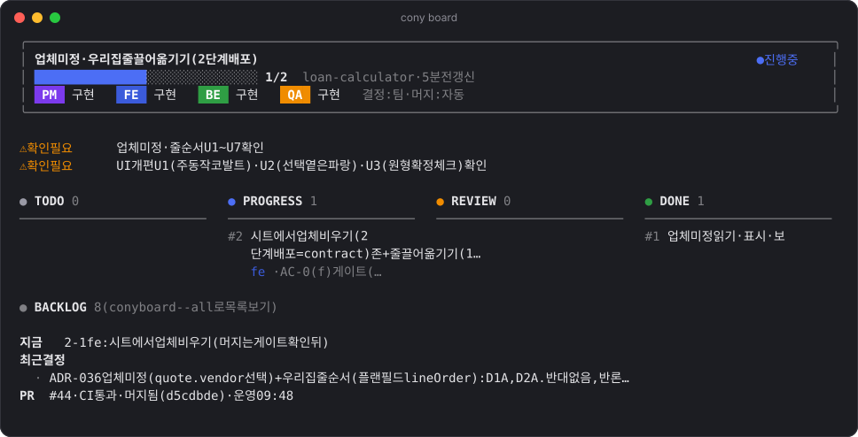
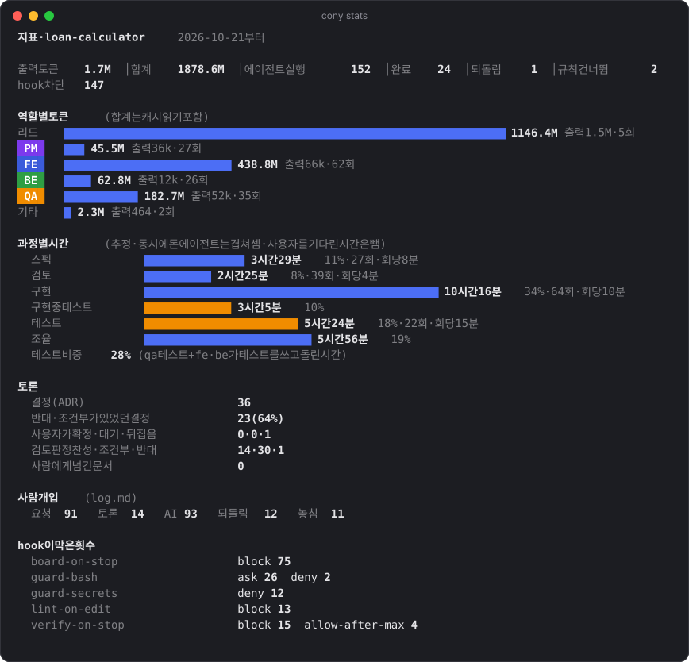

# cony

<p align="center">
  
</p>

**cony**는 Claude Code용 개인 하네스 플러그인이다.
목표를 한 줄 주면 `pm`(기획) · `fe`(클라이언트) · `be`(백엔드) · `qa`(테스트) 네 에이전트가 토론해서 결정하고, 기능을 머지까지 만든 뒤 보고한다.
사람은 진행 상황을 지켜보다가 꼭 필요한 결정만 내린다.

## 빠른 시작

```bash
claude plugin marketplace add hwanyoungChoi/cony
claude plugin install cony@conychoi-plugins
claude plugin install development@conychoi-plugins   # 같은 이름의 플러그인이 없는 컴퓨터에서만
```

```
/cony:setup                       # 새 프로젝트에 한 번. lint, CI, .cony/ 작업 공간, 팀 구성
/cony:team 프로필 사진 업로드 기능   # 목표를 주면 팀이 끝까지 진행
/cony:status                      # 언제든 중간보고 (다른 세션이나 폰에서도)
/cony:team 이어서                  # 멈춘 작업이나 다음 사이클을 새 세션에서 이어가기
```

## 어떻게 동작하나

1. **토론으로 결정한다.** 리드(메인 세션)가 pm의 제안을 fe·be·qa에게 검토시키고, 근거를 따져 결정한다. 결정은 ADR로, 검토 의견은 원문 그대로 남는다.
2. **칸반으로 진행한다.** 태스크는 TODO → PROGRESS → REVIEW → DONE으로 움직인다. qa 검증에 실패하면 PROGRESS로 돌아간다.
3. **hook이 지킨다.** force push, CI 통과 전 머지, 지침 파일 수정, 비밀 파일 읽기, lint 오류를 막는다.
4. **사람은 보고를 받는다.** 보드나 폰으로 지켜보다가, 머지 완료와 확인할 결정을 보고받는다.

## 진행 상황 보기

### 터미널

셸 설정(`~/.zshrc` 등)에 함수를 한 번 넣어 두면, cony 프로젝트 폴더 어디서든 쓸 수 있다. 플러그인이 업데이트돼도 항상 최신 버전을 가리킨다.

```bash
cony() { node "$(ls -d ~/.claude/plugins/cache/conychoi-plugins/cony/*/ | sort -V | tail -1)skills/board/cli.mjs" "$@"; }
```

```
cony board          # 칸반, 확인 필요·막힌 것, 최근 결정 (--all: 백로그까지)
cony stats          # 역할별 토큰, 흐름, 토론, 사람 개입, hook 차단
cony watch          # 띄워 두면 바뀔 때마다 다시 그린다 (cony watch stats 도 된다)
```

<p align="center">
  
</p>
<p align="center">
  
</p>

실제 프로젝트(모기지핏)를 진행하는 중에 찍은 화면이다. 터미널이 좁으면 칸반을 세로 목록으로 보여주고, `NO_COLOR=1`로 색을 끌 수 있다.

### 브라우저

`/cony:board`를 실행하면 로컬 대시보드(`localhost:4747`)가 열린다.

- **보드 탭**: 칸반(BACKLOG · TODO · PROGRESS · REVIEW · DONE), 확인 필요·막힌 것 배너, 결정 기록, 검토 기록, 사람에게 넘길 문서. 리드가 보드를 고치는 즉시 바뀐다.
- **지표 탭**: cony가 값어치를 하는지 숫자로 보여준다. 역할별 토큰, 완료 태스크와 소요 시간, qa 되돌림, 반대 의견이 있었던 결정 비율, 사람이 뒤집은 결정, hook이 막은 횟수.

같은 크기의 기능을 cony 팀과 일반 세션으로 하나씩 만들어 지표를 비교하면, 팀 구조의 효과를 판단할 수 있다.

### 폰

1. 데스크톱 앱에서 `/cony:team`을 시킨 세션의 **Remote Control**을 켠다.
2. Claude 모바일 앱이나 claude.ai/code에서 그 세션을 열어 지켜보고 지시한다.
3. 중간보고는 `/cony:status`. 리드 세션이 멈춰 있으면 알려주고, 원하면 재개 메시지를 보낸다(데스크톱 앱에서만).

팀은 사람이 확인해야 할 때, 전부 막혔을 때, 머지를 보류할 때, 머지했을 때만 푸시 알림을 보낸다. Remote Control은 세션을 돌리는 컴퓨터가 켜져 있어야 한다.

## 팀

| 에이전트 | 역할 | 만들 때 | 검토할 때 보는 것 |
|---|---|---|---|
| `pm` | 기획 | 스펙, 태스크, 선택지 | 요구사항, 범위 |
| `fe` | 클라이언트 | 화면, API 연동 | 화면 흐름, 사용성 |
| `be` | 백엔드 | DB, 마이그레이션, API | 데이터 무결성, 보안, API 계약 |
| `qa` | 테스트 | 테스트 작성·실행 | 테스트 가능성 |

### 토론 방식

에이전트끼리는 직접 대화하지 않는다. 리드가 의견을 전달하며 토론을 진행한다.

1. **제안**: 담당자가 선택지 2~3개와 추천을 낸다.
2. **검토**: 관련된 역할들이 동시에 찬성·반대와 근거를 낸다.
3. **반론**: 이견이 있으면 제안자가 한 번 답한다.
4. **결정**: 리드가 근거로 판정한다. `CLAUDE.md` 제약 → 작업 원칙 → 테스트 가능성 → 되돌리기 쉬운 쪽 순서로 따진다.
5. **기록**: 결정은 `.cony/decisions/`에, 검토 원문은 검토자가 직접 `.cony/reviews/`에 남긴다.

검토는 읽고 판정만 하므로 `sonnet`으로, 첫 스펙과 구현은 에이전트 기본 모델로 부른다.

### 사람에게 묻는 경우

팀은 대부분 스스로 정한다. 아래만 사람에게 묻는다.

- 되돌릴 수 없는 일: 배포, 데이터 삭제, 유료 서비스, `main`에 직접 push
- 지침 파일(`CLAUDE.md`, `.claude/`) 변경
- 해석에 따라 제품 목표가 갈리는 요구사항
- 쓰는 경험을 좌우하는 제품 기본값: 기본값, 포함·제외 항목, 저장 후 동작, 화면 취향. 제안값으로 진행하면서 확인을 요청한다.

### 실제 실패에서 나온 규칙

| 규칙 | 담당 | 계기 |
|---|---|---|
| 제품 기본값은 제안값으로 진행하고 사람에게 확인 | 리드, pm | 사람이 뒤집은 결정 5개가 전부 이 종류였다 |
| 외부 입력(공유 텍스트, 파일, 외부 API 응답)에 기대는 기능은 실제 샘플부터 | pm | 가정으로 만든 붙여넣기 기능이 통째로 삭제됐다 |
| 스펙 검토 때 수용 기준의 예시 값을 직접 계산 | qa | 내림과 반올림을 구분 못 하는 예시, 틀린 경계 예시가 있었다 |
| 비밀 파일을 읽지 않고, 실제 키로 외부 API를 부르기 전에 확인 | be (+ hook) | 테스트 중 `.dev.vars`의 실제 키로 외부 API를 불렀다 |
| 한 번에 태스크 3개, 수용 기준 8개 이하 | pm | "계산기 만들어줘" 한 줄에 수용 기준이 20개 나왔다 |

## 프로젝트별 설정 (`.cony/team.json`)

**옵션을 외울 필요는 없다.** `/cony:team`을 처음 시작할 때 파일이 없으면 리드가 묻는다. 가장 흔한 설정은 "개인 프로젝트"(전원 build, 결정 team, 머지 auto)이고, 나머지는 하나씩 고를 수 있다.

```json
{ "pm": "build", "fe": "build", "be": "review", "qa": "build", "decisions": "user", "merge": "pr" }
```

### 역할마다: 누가 만드나

| 값 | 뜻 | 예 |
|---|---|---|
| `build` | 에이전트가 직접 만든다 | 혼자 하는 프로젝트 |
| `review` | 사람이 만들고, 에이전트는 검토와 **넘길 문서**만 쓴다 | 백엔드를 다른 팀이 맡으면 `be: review` |
| `off` | 이 프로젝트에 없다 | 서버 없는 정적 사이트면 `be: off` |

넘길 문서는 `.cony/handoffs/`에 남고 보드에 보인다. pm은 기획 질의서, fe는 구현 요청서, be는 백엔드 요청서(엔드포인트, 요청·응답 예시, 에러), qa는 테스트 시나리오를 쓴다. be가 `review`면 fe는 API 계약대로 목 데이터로 화면을 먼저 만든다.

### `decisions`: 큰 결정을 누가 확정하나

| 값 | 뜻 |
|---|---|
| `team` (기본) | 팀이 토론으로 확정한다. 제품 기본값만 묻는다 |
| `user` | 팀은 선택지, 검토 의견, 추천까지만 낸다. 확정은 사람이 한다 |

`user`는 사람의 판단이 기록에 드러나야 하거나, 결정 권한이 사람에게 있을 때 쓴다. 되돌리기 쉬운 구현 세부는 어느 쪽이든 담당 에이전트가 정한다.

### `merge`: 어디까지 팀이 마무리하나

hook이 강제한다.

| 값 | 팀이 하는 것 | 사람이 하는 것 |
|---|---|---|
| `auto` (기본) | 커밋, push, PR, CI 통과 후 머지 | 보고 검토 |
| `pr` | 커밋, push, PR, CI 확인 | 코드 리뷰와 머지 |
| `none` | 작업 브랜치에 커밋 | push, PR, 머지 |

### 중간에 바꾸기

"be 투입", "qa는 빼", "결정은 내가 할게"처럼 말하거나 파일을 고치면 다음 태스크부터 적용된다. 새로 들어온 역할은 지금까지의 스펙, 결정, 변경을 먼저 검토하며 따라잡는다.

## 머지까지

`merge`가 `auto`일 때의 흐름이다. `pr`이면 CI 확인까지, `none`이면 커밋까지 하고 멈춘다.

1. `cony/{feature}` 브랜치에서 태스크마다 커밋하고 push한다.
2. 끝나면 최종 보고서를 본문으로 PR을 만든다.
3. CI가 실패하면 담당 에이전트가 최대 두 번 고친다.
4. CI가 모두 통과하면 squash 머지한다. hook이 머지 직전에 CI 결과를 다시 확인한다.
5. 머지 후에도 PR과 결정 기록이 남아서, 나중에 팀의 결정을 검토하고 뒤집을 수 있다.

개인 계정 private 저장소는 무료 플랜에서 브랜치 보호를 쓸 수 없어서, "CI 통과 후 머지"를 hook으로 강제한다. CI 워크플로는 `/cony:setup`이 만든다.

## 안전장치와 한계

hook은 `.cony/`가 있는 프로젝트에서만 동작하고, 다른 프로젝트에는 영향이 없다. 세션을 연 폴더가 아니어도, 수정한 파일이나 `cd`·`git -C`로 들어간 위치가 cony 프로젝트면 동작한다. 단 종료 전 검증은 이 세션이 **실제로 파일을 고친** 프로젝트만 한다. 명령만 실행한 프로젝트까지 검증하면 다른 세션이 작업 중인 코드를 대신 붙잡게 된다.

**막는 것**
- 지침 파일(`CLAUDE.md`, `.claude/`) 수정. 사람만 고친다.
- 비밀 파일(`.env`, `.dev.vars`, 키 파일) 읽기. 예시 파일은 허용한다.
- `--no-verify`, `--amend`, force push
- CI가 통과하지 않은 PR 머지, `merge` 설정을 넘어서는 push·PR·머지
- 단계 건너뛰기. qa 기록과 커밋 없이는 태스크를 DONE으로 옮길 수 없다(`--skip-reason`으로 넘기면 기록이 남는다).

**알려주는 것**
- 파일을 고치는 즉시 ESLint 오류
- 턴을 끝내기 전 lint와 타입 오류. 고칠 때까지 끝내지 못한다.
- 보드가 "진행 중"인 채로 리드가 턴을 끝내려 할 때
- 리드 세션이 끝나면 보드를 "중단됨"으로 표시한다. 상태만 보는 다른 세션은 영향을 주지 않는다.

**사람 확인을 받는 것**: `main`에 직접 push, `reset --hard`, `rm -rf`, DB 초기화

**못 막는 것**
- 스크립트나 개발 서버가 비밀 파일을 알아서 읽는 경우. 명령에 파일 이름이 보이지 않아 hook이 알 수 없다. be 규칙으로 따로 막는다.
- 팀 흐름 중 스펙 토론과 ADR 작성은 아직 지시문에 의존한다. 코드로 막는 건 태스크 단계뿐이다.

## 하네스 설계

| 요소 | 질문 | cony가 갖춘 것 |
|---|---|---|
| 컨텍스트 | 무엇을 알고 시작하나 | `CLAUDE.md`, 컨벤션, 스펙, 결정 기록, 세션 시작 시 보드 |
| 도구 | 무엇을 할 수 있나 | 역할별 에이전트, 브라우저·시뮬레이터 화면 확인 |
| 제약 | 무엇을 막나 | 위 "막는 것" |
| 피드백 | 틀린 걸 어떻게 아나 | 즉시 lint, 종료 전 검증, qa의 독립 검증 |
| 흐름 | 어떤 순서로 일하나 | `/cony:team` 절차, `board.mjs`의 단계 검사 |
| 개선 | 실수가 어떻게 규칙이 되나 | 작업 기록의 `되돌림`·`놓침` → 규칙 제안 → 사람이 승격, 지표로 효과 측정 |

## 작업 공간 `.cony/`

| 경로 | 내용 |
|---|---|
| `board.md` | 현황판. 리드가 `board.mjs`로 갱신한다 |
| `team.json` | 프로젝트별 설정 |
| `specs/` | 스펙과 태스크 |
| `decisions/` | 결정 기록(ADR) |
| `reviews/` | 검토 원문과 qa 검증 기록. 파일 이름이 `시각-역할-대상`이라 이름순이 곧 시간순이다 |
| `handoffs/` | 사람에게 넘길 문서 |
| `log.md` | 작업 기록 (`요청` / `토론` / `AI` / `되돌림` / `놓침`) |
| `reports/` | 최종 보고서 |
| `metrics/events.jsonl` | 태스크 상태 변화, 규칙 건너뜀, hook 차단 기록 |
| `.cache/` | hook 상태 (git에서 제외) |

## 플러그인 구성과 업데이트

| 플러그인 | 내용 | 원본 |
|---|---|---|
| `cony` | 하네스: 에이전트, hook, team·board·status·setup 스킬 | 이 저장소 |
| `development` | `commit-message`, `code-review-fe`, `spec-review` 스킬 | [my-plugins](https://github.com/hwanyoungChoi/my-plugins) |

- 팀은 기획서가 있으면 `spec-review`, REVIEW 단계에서 `code-review-fe`, 커밋할 때 `commit-message`를 쓴다.
- `development`는 my-plugins 저장소를 가리키기만 한다. 스킬은 거기서 고친다.
- 같은 이름(`development`)의 플러그인을 이미 쓰는 컴퓨터에는 설치하지 않는다. 스킬 이름이 겹친다.

```bash
claude plugin marketplace update conychoi-plugins
claude plugin update cony@conychoi-plugins
```

업데이트는 **실행 중인 세션에도 바로 반영된다.** 에이전트나 스킬 이름처럼 호환이 깨지는 변경은 팀이 작업 중인 세션을 끊을 수 있으니, 그 세션이 쉬는 틈에 올린다.

## 개발

hook이나 스크립트를 고친 뒤에는 테스트를 돌린다. 실제 ESLint·tsc·gh 대신 가짜 실행 파일을 써서 의존성 없이 몇 초 만에 끝난다. push하면 GitHub Actions에서도 돈다.

```bash
node --test tests/hooks.test.mjs tests/board.test.mjs tests/stats.test.mjs tests/cli.test.mjs
```
